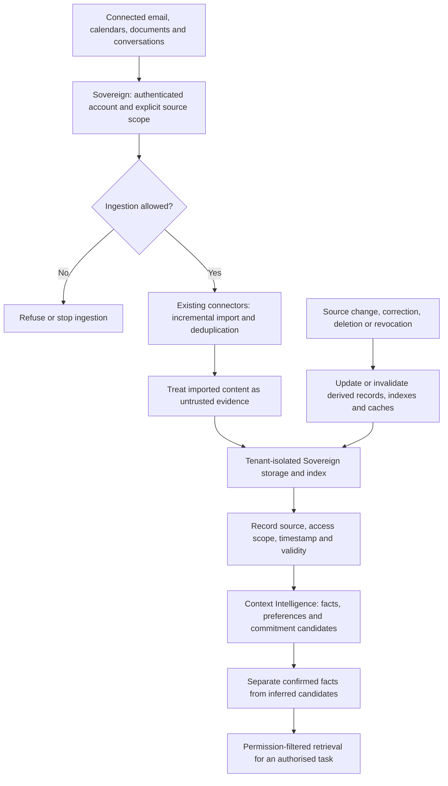
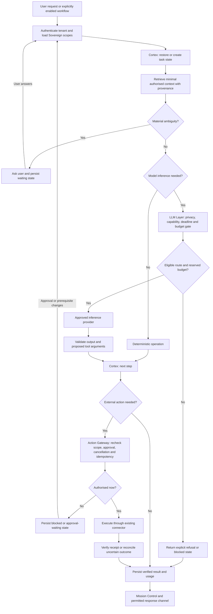
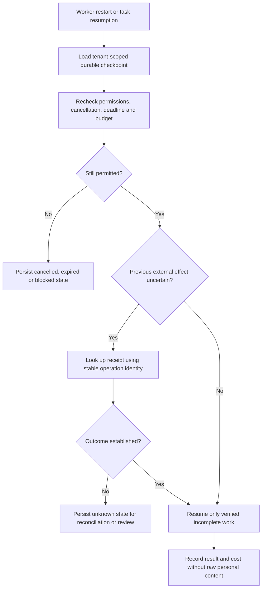

# AJ inference strategy and certification plan

Date: 24 October 2026
Status: Owner-approved direction; implementation and certification pending.
Release: HOLD. No merge, deployment, provider provisioning, paid capacity commitment or production activation authorised by this document.

## Decision
Buy managed inference initially. Extend AJ-LLM-Layer rather than introduce a parallel router or runtime. AJ owns context selection, privacy policy, orchestration, authorisation, execution and verification. Do not train a foundation model. Evaluate dedicated or self-hosted open-weight inference only against measured economics or specific privacy requirements.

This is a plan, not evidence that these capabilities are implemented. Repository README confirms intended scope only; a source audit remains required.

## Architecture and ownership
- Sovereign supplies authenticated tenant identity, processing scopes, data classification and allowed provider/model/region policy.
- Context Intelligence supplies minimal relevant context with provenance and deletion/revocation constraints.
- Cortex owns task planning and workflow recovery.
- LLM Layer owns approved model selection, provider adapters, capability compatibility, budgets, timeouts, circuit state and inference telemetry.
- Action Gateway validates and executes actions, including approvals and idempotency.
- Mission Control displays verified state and outcomes.

Preserve existing ownership boundaries. Audit existing implementations and interfaces in both repositories before code changes; record reuse and gaps. Account identity must come from authenticated context, not model-supplied fields.

## Execution policy
1. Use deterministic software for exact lookups, calculations, permission checks and receipt verification.
2. Use an economical qualified model for bounded extraction, classification and routine summarisation.
3. Use a qualified reasoning model when complex planning or ambiguity requires it.
4. Validate structured outputs before use; model output never grants permission.
5. Escalation and fallback must remain within provider, region, modality, deadline and budget constraints. Fail closed when no eligible route exists.
6. Personal data remains on the approved OpenAI route until separately approved. Synthetic-only alternative-provider evaluations must contain no production-derived personal data. Shadow calls also require policy and budget checks.

## Work packages
### A: Establish baseline
Audit source, existing tests, configuration and integration paths; inventory provider adapters, routing ownership and outstanding certification. Measure tokens, calls, latency, errors and total cost per completed task. Record current gaps without claiming readiness.

### B: Reduce unnecessary inference
Apply relevant-tool selection and bounded retrieval. Reuse resolved contacts within authenticated workflow scope; invalidate on account changes, logout, revocation and expiry. Avoid repeated planning for deterministic actions. Isolate caches by tenant and policy; prohibit cross-account reuse.

### C: Harden the existing routing interface
Use an internal request contract carrying authenticated tenant, task identifier, workload class, data class, provenance references, eligible providers/models/regions, token limits, deadline and remaining budget. Do not trust client overrides.
Return a validated result or typed refusal/error with provider/model/version, usage, cost basis and correlation identifier.
Reserve estimated cost before calls, bound input and output, reconcile actual usage, and account for retries, fallback and shadow calls. Mark missing usage as unknown and handle conservatively. Keep model/tool accounting distinct while enforcing an overall task budget.
Avoid raw prompts and personal content in routine logs.

### D: Synthetic benchmark
Compare the existing approved route with one candidate supplier selected after capability, privacy and commercial review. Use identical fixtures and record model version, serving configuration, date and parameters. Do not rank suppliers solely by tokens/second.
Score task success, valid tool arguments, extraction accuracy, refusal correctness, time to first token, total and tail latency, retries and cost per successful task. Include provider outages and schema incompatibilities.

### E: Controlled adoption
No automatic activation. Retain HOLD until security, privacy and reliability gates pass and explicit release approval is received.
Consider private inference only after a model passes quality tests and total operating cost includes idle capacity, redundancy, engineering, security and maintenance. Serving existing licensed weights is distinct from training.

## Acceptance gates
- Existing source and interface audit identifies reused components; no duplicate router/runtime.
- Exact deterministic fixture completes without a model call.
- Personal-data request cannot route or fail over to an unapproved processor.
- Synthetic routing honours model capability and regional constraints.
- Tenant A context, resolved contacts and cache entries never appear for tenant B.
- Logout, revocation and expiry invalidate scoped reusable state and block subsequent unauthorised use.
- Oversized context is bounded or refused before a supplier request.
- Retries, escalation and shadow calls cannot exceed the reserved overall budget; unknown usage is not treated as free.
- Malformed tool arguments are rejected; inference cannot bypass Action Gateway approval or idempotency.
- Timeout and circuit-breaker paths produce explicit recoverable state without repeating an external action.
- Routine logs exclude prompt bodies and personal content; provenance and usage metadata remain traceable.
- Failed, missing or incomplete benchmark/test evidence blocks certification.

Define numerical quality and latency thresholds from the baseline before comparing candidates. Targeted tests precede integration and full regression checks. Report exact commits, commands, fixtures, results and blockers; synthetic evidence does not certify live IAM, retention or regional controls.

## Commercial decision
No supplier winner selected. Compare contract terms, retention/training policy, subprocessors, residency, deletion, availability, tool compatibility and workload performance before approval. Evaluate API and dedicated costs using actual volume and utilisation; user count alone is insufficient.

## Evidence and sequencing
This work must not weaken or obscure the existing Cloud Build recovery gate. Keep planning isolated from recovery changes. Before implementation, reconcile the latest application and LLM-Layer heads and applicable repository instructions. No claim of implementation, passing tests or production readiness follows from approval of this strategy.

## Additional owner-approved improvements (24 October 2026)
Planning requirements below are approved; implementation and verification remain pending. Extend the existing components after the source audit rather than introducing parallel services.

| Priority | Work | Existing owner | Required evidence |
| --- | --- | --- | --- |
| P0 | Measure end-to-end task outcomes and cost | Cortex, LLM Layer, Mission Control | Correlated model/tool/retry usage; verified success, partial, failed, cancelled and unknown outcomes; completion time; cost per successful task including failed-attempt spend |
| P0 | Full user-journey evaluation | Existing evaluation harness and component owners | Synthetic coffee scheduling, morning briefing and flight search, including account changes, revoked permissions and supplier failures; expected receipts/state, not model self-reported success |
| P0 | Durable safe recovery | Cortex and Action Gateway | Restart/resume fixtures before and after external effects; reconcile uncertain outcomes; no blind replay or duplicate messages, bookings or payments |
| P1 | Fresh, correctable personal context | Sovereign and Context Intelligence | Source, timestamp, validity and confirmed/inferred distinction; corrections invalidate derived retrieval/cache entries; revocation and deletion propagate |
| P1 | Prompt acknowledgement, progress and cancellation | Cortex, Mission Control and Action Gateway | Acknowledgement does not claim completion; cancellation stops queued work, is rechecked before side effects, and reports already completed or uncertain actions |
| P1 | Controlled model upgrades | LLM Layer and existing evaluation harness | Versioned fixtures/configuration, baseline comparison, qualified rollback within current privacy policy; no silent activation |

### Untrusted-source boundary
Treat imported email, webpages, documents and retrieved text as untrusted evidence. Embedded instructions cannot grant permissions, choose unapproved processors, change policy or authorise tool execution. Enforce this through trusted policy and tool validation, not prompt wording alone.
Acceptance: adversarial retrieved-content fixtures cannot disclose cross-tenant context, alter routing permissions or trigger unauthorised actions. Include this boundary in P0 journey certification.

### Monthly user allowances
Add an aggregate monthly inference allowance alongside task-level caps, with separately visible foreground, scheduled/background and experimental shadow usage. Select allowance amounts from measured economics; no price or product tier is set here.
Use atomic reservations across concurrent workers, reconcile usage, and avoid treating unknown charges as zero. Specify the billing timezone, period boundary and handling of in-flight reservations before implementation.
Acceptance: simultaneous jobs cannot overspend the shared allowance; retries and shadow calls count; exhaustion blocks new billable inference with a clear explanation; month-boundary and reconciliation tests prevent allowance reuse or accidental reset.
Task history and status access should remain available when inference allowance is exhausted.

### Delivery order and status
After the source audit, prioritise outcome/cost measurement, durable recovery and full journey tests, including the untrusted-source boundary. Follow with context freshness, cancellation, upgrade controls and aggregate allowance implementation.
Allocate cross-repository changes to existing owners; this LLM-Layer plan does not transfer Cortex, Sovereign or Action Gateway ownership. Keep recovery work isolated from Cloud Build repair.
All additions are documentation requirements only until implementation commits and test evidence are recorded. Existing personal-data routing restrictions and release HOLD remain in force.

## Approved everyday-assistance roadmap (24 October 2026)
Owner approved these roadmap additions in conversation. They are requirements, not implemented features. Reliability, privacy and certification work above retains precedence. Map implementation into existing application components after the source audit; this document does not create new LLM-Layer ownership of application services.

| Order | Capability | Existing owners | Acceptance evidence |
| --- | --- | --- | --- |
| 1 | Commitment tracking | Context Intelligence, Cortex, Mission Control | Source-backed records distinguish discussion, proposal and actual commitment; record responsible person, deadline/timezone and status; allow correction, dismissal and completion with evidence |
| 2 | Dependency tracking | Cortex, Action Gateway | Block dependent actions until prerequisites are verified; detect cycles, missing prerequisites and revoked permissions; expose blocked reasons |
| 3 | Explainable suggestions | Context Intelligence, Mission Control | Show supporting sources, freshness and assumptions; enforce source access at display time; inferred suggestions cannot authorise execution |
| 4 | Selective clarification | Cortex | Ask when ambiguous identity, authority, amount, time or scope could materially change the result; use confirmed low-impact preferences when appropriate; do not silently guess recipients |
| 5 | User-defined autonomy | Sovereign, Cortex, Action Gateway | Reviewable grants bind task scope, permitted actions, recipients/resources, spend, duration and approval requirements; revocation blocks subsequent actions; no implied expansion from model output |
| 6 | Notification discipline | Cortex, existing notification delivery, Mission Control | Consolidate routine updates, deduplicate, respect channel permissions, quiet hours and timezone; recheck settings at delivery; priority labels cannot override disabled notifications |
| 7 | Personal preference learning | Sovereign, Context Intelligence | Explicit corrections create reviewable, source-backed preferences; distinguish inferred candidates from confirmed preferences; support edit, delete, expiry and conflict handling; never infer consent |
| 8 | Weekly value view | Mission Control, existing task/usage records | On-demand view of verified completions, pending deadlines, failures and spend; distinguish unknown/partial outcomes and missing usage; avoid invented time-saved estimates |

### Commitment tracking first
Start with synthetic fixtures for an explicit promise, tentative discussion, cancelled promise, changed deadline, duplicate ingestion and revoked source. Maintain stable identity across updates, preserve provenance and prevent duplicate tasks or reminders. Statements by other people must not become the user's commitments.
Retention, deletion and source revocation must propagate to derived records according to Sovereign policy. Treat source instructions as untrusted. Commitment detection alone never grants permission to contact someone, purchase or book.

### Settings and rollout
Proactive suggestions and notifications remain disabled under current settings until explicitly enabled through existing controls. The weekly view is on demand; this roadmap does not create a scheduled digest or automation. Task history remains governed by its existing setting.
Autonomy settings must be enforced by deterministic permission checks and cannot bypass required approvals, data routing policy or overall budgets.
Prototype with synthetic data, verify boundaries and user correction flows, then run relevant integration and regression checks. No new supplier, autonomous activation, merge or deployment follows from roadmap approval.

## Architecture and inflow diagrams
These diagrams describe the approved target design, not certified current implementation. Source audit must map each box to existing services before code changes. "Inflow" covers both authorised source ingestion and task/inference requests.

### 1. Connected information inflow

Read scope is checked during ingestion and again during retrieval. Revocation must block access immediately; cleanup propagates to derived state. Embedding, extraction and summarisation calls made during ingestion are inference requests too: they use the same approved-processor and budget gates as task inference. No raw source content is sent to an alternative provider merely because it is being indexed. Imported instructions never become permissions.

### 2. Task and inference flow

Invalid model output returns a typed failure or a bounded repair attempt through the same gate; it cannot reach execution unchecked. Provider failure or escalation re-enters the gate, rechecking policy and remaining budget. Uncertain action outcomes remain unknown until reconciliation; they are not reported as success or blindly retried. A multi-step task persists its verified step and returns to Cortex; final output is delivered only through an allowed channel.

### 3. Recovery, cancellation and model change controls

Confirmed prior success skips replay; confirmed failure is retried only when safe and authorised. Cancellation prevents queued actions and reports effects already completed or still uncertain. Model upgrades and rollbacks require a qualified evaluation result and current provider eligibility; changing models never changes execution permissions.

### Flow example: arrange coffee
1. Authenticate the requester and resolve the contact within the correct account.
2. Retrieve permitted calendar availability and confirmed preferences.
3. Clarify material ambiguity; do not infer a recipient or external-action consent.
4. Use deterministic slot checking; call a qualified model only where interpretation or drafting adds value.
5. Show the proposed invitation if approval is required; persist waiting state.
6. Recheck current authority and cancellation before sending through the existing connector.
7. Verify the actual send/event receipt; save task state and cost; report the outcome.
8. After interruption, reconcile before any resend. Do not create duplicate invitations.

No diagram activates ingestion, notifications, suppliers or autonomous execution. Release HOLD remains.
